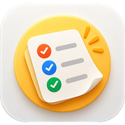
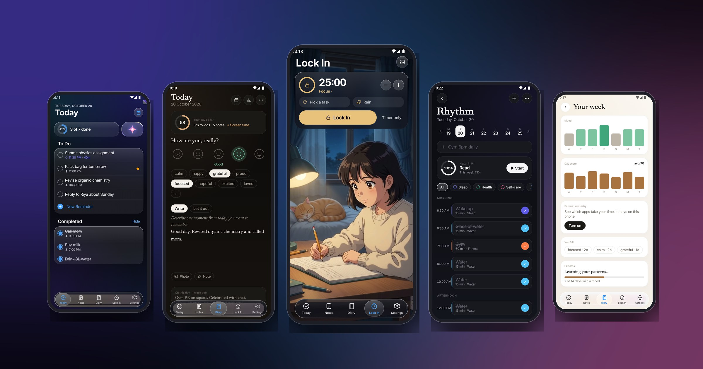
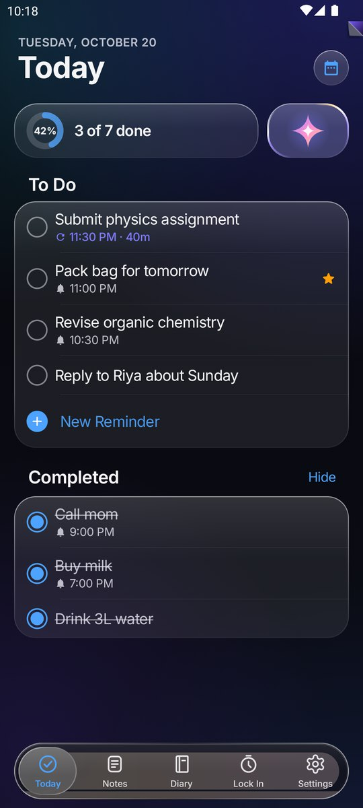
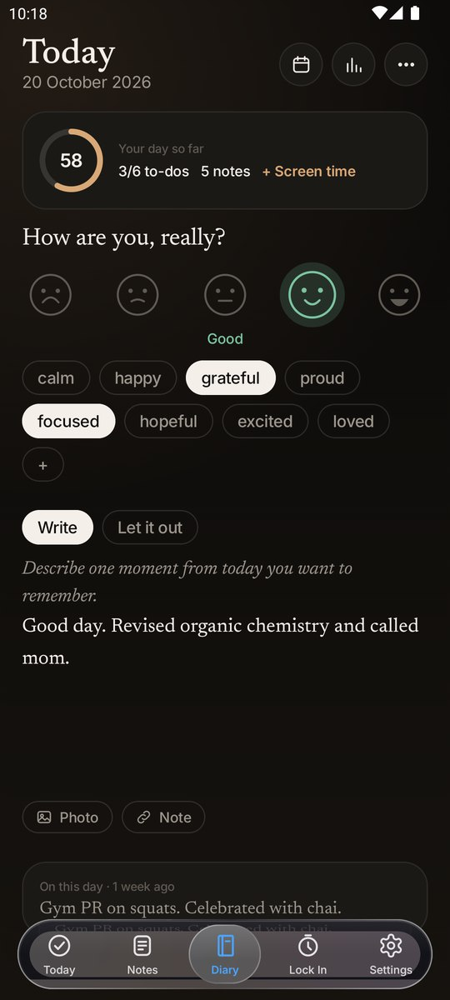
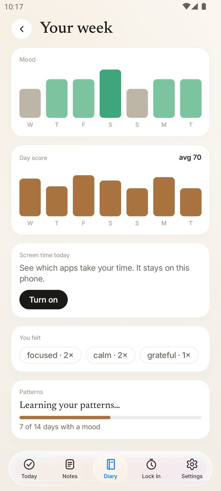
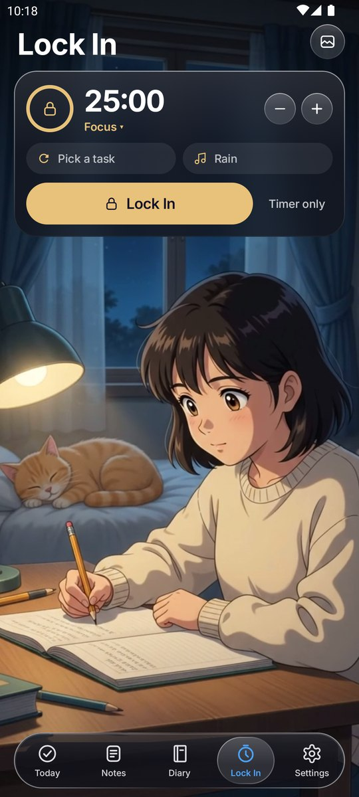
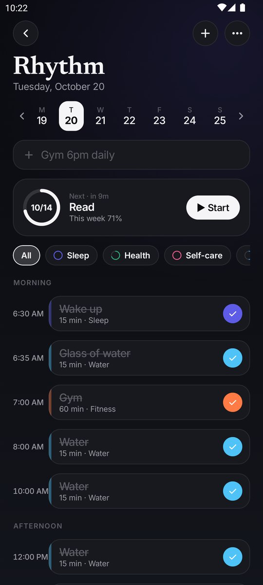
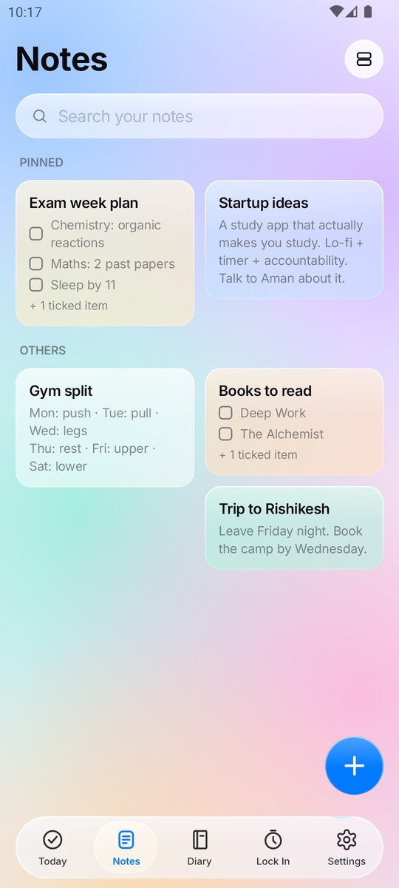
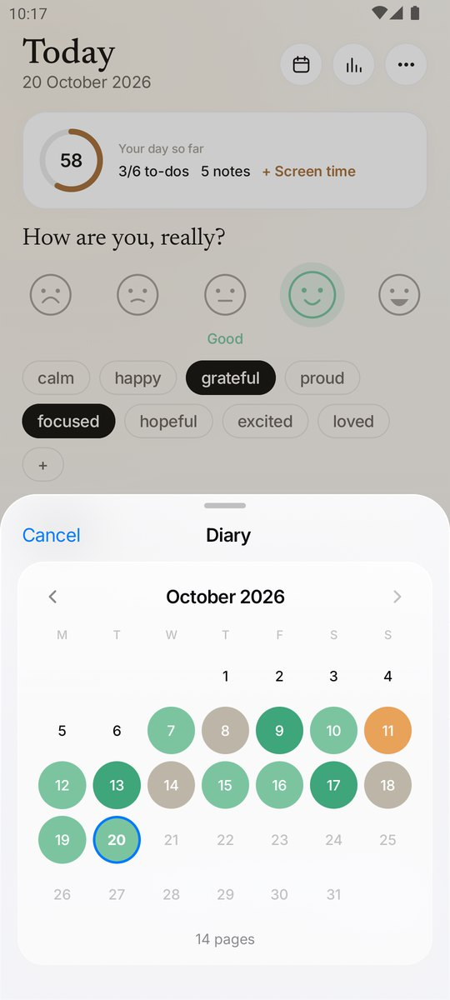
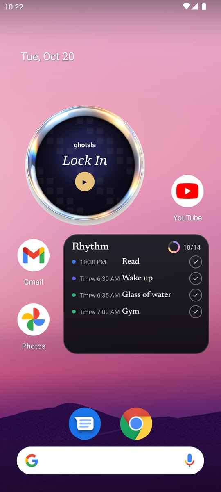

  

<h1 align="center">Ghotala</h1>

  <b>Your day, your routine, your focus. One calm app.</b> 
  To-dos that don't get lost · Rhythm · Diary · Alarm · Lock In · Notes · Score · Vault

  
  
  

  

Free · no ads · no account · your data stays on your phone

---

## ✨ What's inside

| | |
|---|---|
| ✅ **Today** | A to-do list for each day. Type *"Call mom at 6pm"* and the time sets itself. Anything unfinished moves to tomorrow. |
| 🔁 **Keep reminding me** | Tasks with a deadline that nag you, a bit more each time, until they're done. |
| 🌿 **Rhythm** | Your daily routine on a timeline. Add a block in one line: *"Water every 2 hours from 8am to 10pm"*. |
| 📖 **Diary** | A chat with yourself, one day at a time: write messages, check in your mood any time (delete any you didn't mean), pick feelings, add photos. Speak instead of typing. Insights from day 3, and on a rough day, a good day from before. |
| 🔒 **Lock In** | Focus, Pomodoro or Sleep. A new scene each time, and a real music player (shuffle, repeat, queue, seek) for Ghotala's music, your own songs, or Spotify and YouTube Music. |
| 📝 **Notes** | Every note is a chat with yourself: messages with times, checklists, photos, drawings and voice notes. Edit, copy, remind or delete right under each message, with undo. Give a note a photo or emoji. Lock any note with your Vault PIN or fingerprint. |
| 📅 **Calendar** | Month, week, day and list views with India's holidays and festivals, plus your reminders, note reminders, Rhythm, alarms and moods. |
| ⏰ **Alarm** | 13 missions to turn it off: math, typing, memory, shake, squats, steps, QR code, two codes in two rooms, photo, number order, odd one out, catch the dot, hold flat. Harder after a week of snoozing. Alarm series, every other day, chosen dates. Your phone's alarm tones, Ghotala's, or your own songs. Sunrise screen, flashlight, talking alarm, naps, wake-up check, backup alarm, morning routine and a good-morning card. *Try it now* rings once without saving. Free. |
| 📈 **Score** | Today's score, insights worked out on your phone, screen time, and *Ask AI about your month*: export the data you pick to Claude, Gemini or ChatGPT. |
| ↶ **Undo everything** | 5-second Undo after every tick, snooze, move or delete. Undo / Redo while writing, or shake your phone. |
| 🔐 **Vault** | Passwords and secure notes, encrypted on your phone. Pull down on Today to open it. |
| 🔔 **Smart notifications** | Snooze to 10 min, 1 hour, tonight or tomorrow. Log your mood from the diary reminder. Choose your own diary and nudge times. Nothing soft comes on Do Not Disturb. |
| 🧭 **Guide** | A short tour on first open, "What's new" after each update, and every tip again in Settings. |
| 📥 **Downloads** | Lock In scenes, reminder sounds and alarm sounds. Download, then tick what each feature should use. The app stays small. |
| 🧩 **Widgets** | Today, Rhythm (tick blocks off from the home screen) and the Ghotala dock: Today, Rhythm, Notes, Diary, Lock In and Vault in one tap, with your next alarm. |
| ☁️ **Backup** | Optional: everything goes to a *Ghotala* folder in **your own** Google Drive. |

## 📸 Screenshots

<table>
  <tr>
    <td></td>
    <td></td>
    <td></td>
    <td></td>
  </tr>
  <tr>
    <td align="center">Today</td><td align="center">Diary</td><td align="center">Your week</td><td align="center">Lock In</td>
  </tr>
  <tr>
    <td></td>
    <td></td>
    <td></td>
    <td></td>
  </tr>
  <tr>
    <td align="center">Rhythm</td><td align="center">Notes</td><td align="center">Month of moods</td><td align="center">Widgets</td>
  </tr>
</table>

## 📲 Install

1. **[Download Ghotala.apk](https://github.com/PriyanshuAyodhyawasi/ghotala-releases/releases/latest/download/Ghotala.apk)** on your Android phone.
2. Open it. If Android asks, allow installing from your browser or Files app.
3. Open Ghotala. The quick tour shows you around in five tips.

**Updates:** when a new version is out, Ghotala shows *"Update now"* on Today and installs it for you. Your data is kept.
Prefer automatic updates? Add this repo in [Obtainium](https://github.com/ImranR98/Obtainium):
`https://github.com/PriyanshuAyodhyawasi/ghotala-releases`

Works on Android 8.0 and newer.

## 🔒 Privacy

- No ads, no analytics, no tracking, no account.
- Everything is stored on your phone. Google Drive backup is optional and goes to **your** Drive.
- The Vault and locked notes are encrypted with your PIN. A locked Diary hides from screenshots and recent apps.
- Alarm missions (camera, steps) work on your phone. Songs you pick for alarms are played in place, never copied or uploaded.
- Voice typing uses your phone's speech recognizer.
- Score insights are worked out on your phone. *Ask AI* only shares a file when you pick an app.
- Screen time and music control are optional and stay on your phone.

Full policy: **[Privacy policy](https://priyanshuayodhyawasi.github.io/ghotala-releases/privacy.html)**

## ❓ FAQ

**Is it free?** Yes. No ads, no subscription. 
**Is it on the Play Store?** Not yet. Download it here. 
**Will I lose my data when I update?** No. Updates install over the old version and keep everything. 
**Where's the source code?** The code is private. This repository holds the releases, the website and the downloads.

## 💬 Feedback

Found a bug or have an idea? [Open an issue](https://github.com/PriyanshuAyodhyawasi/ghotala-releases/issues).

Crafted with ❤️ by Chiku · Inspired by TaskPulse by Srijan Rishi

