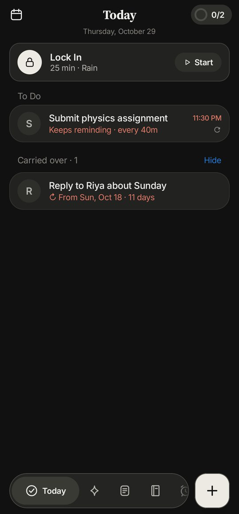
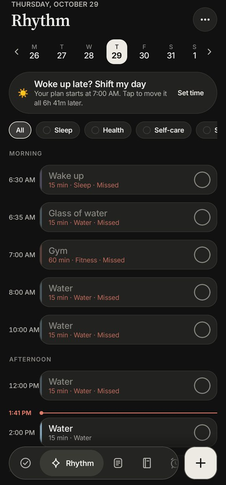
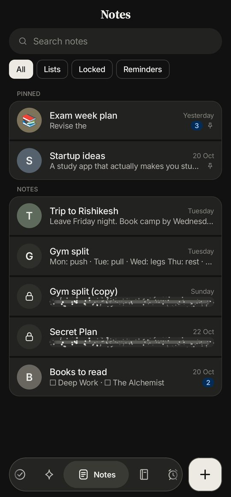
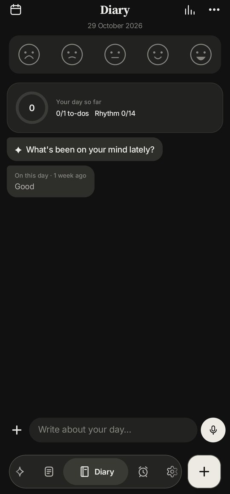
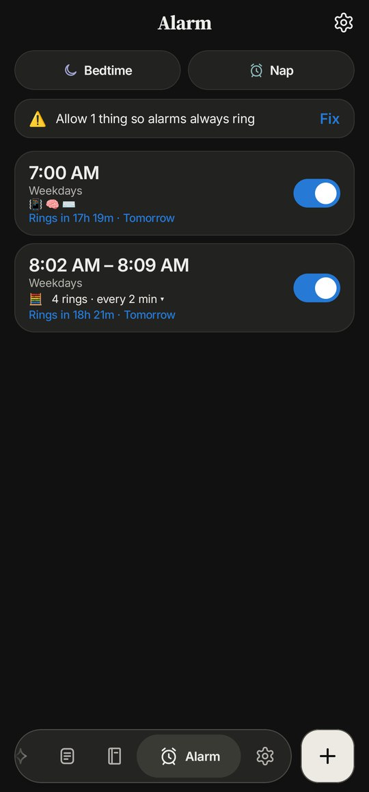

  

<h1 align="center">Ghotala</h1>

  <b>Your day, calmly organised.</b> 
  To-dos, your daily routine, notes, a diary, alarms and focus, in one simple Android app. 
  Talk to it, or just tap.

  <a href="https://github.com/PriyanshuAyodhyawasi/ghotala-releases/releases/latest/download/Ghotala.apk"><b>Download for Android</b></a>
  &nbsp;·&nbsp;
  <a href="https://priyanshuayodhyawasi.github.io/ghotala-releases/">Website</a>
  &nbsp;·&nbsp;
  <a href="https://github.com/PriyanshuAyodhyawasi/ghotala-releases/releases/latest">Latest version</a>

  
  
  
  
  

Free · no ads · no account · your data stays on your phone

---

### What's inside

**Today.** A to-do list for each day. Tap the round picture when it's done. Anything unfinished moves to tomorrow.

**Rhythm.** Your routine on a timeline: water, gym, study, skincare, at their time.

**Notes.** Every note is a chat with yourself: messages with times, lists, photos, drawings and voice notes. Lock secret notes.

**Diary.** Say how you feel with a face, write a line, look back later.

**Alarm.** 13 missions to turn it off, alarm series, naps, your own songs and a morning routine.

**Lock In.** A focus timer with calm scenes and music, or your own songs and apps.

**Calendar, Vault, Insights and widgets.** India's holidays, an encrypted password vault, one clear line about your week, and a home-screen dock that matches your theme.

**Hold ＋ and speak.** On any page, hold ＋ and say what you want to add.

### Ghotala AI

Bring your own AI. Connect your Claude, ChatGPT or Gemini key in **Settings → AI**, then hold ＋ and talk:
*"Remind me to call mom at 6"*, *"Add gym to my routine"*, *"How was my week?"*. It asks what it needs, shows you what it will add, and adds it when you say yes. Your key stays encrypted on your phone; Ghotala has no servers.

### Install

1. [Download Ghotala.apk](https://github.com/PriyanshuAyodhyawasi/ghotala-releases/releases/latest/download/Ghotala.apk) on your Android phone.
2. Open it. If Android asks, allow installing from your browser or Files app.
3. Open Ghotala. A short demo shows you everything.

New versions install from inside the app with *"Update now"*, and your data is kept. Prefer automatic updates? Add this repository in [Obtainium](https://github.com/ImranR98/Obtainium): `https://github.com/PriyanshuAyodhyawasi/ghotala-releases`

Works on Android 8.0 and newer.

### Privacy

No ads, no analytics, no account. Everything is stored on your phone, and the optional Google Drive backup goes to your own Drive. The Vault and locked notes are encrypted with your PIN. Ghotala AI only talks to the AI you connect, only while you use it. [Read the privacy policy](https://priyanshuayodhyawasi.github.io/ghotala-releases/privacy.html).

### Questions

**Is it free?** Yes. No ads, no subscription. Ghotala AI uses your own AI account. 
**Is it on the Play Store?** Not yet. Download it here. 
**Will I lose my data when I update?** No. Updates install over the old version and keep everything. 
**Where's the source code?** The code is private. This repository holds the releases, the website and the downloads.

Found a bug or have an idea? [Open an issue](https://github.com/PriyanshuAyodhyawasi/ghotala-releases/issues).

Crafted with ❤️ by Chiku · Inspired by TaskPulse by Srijan Rishi

